# DTM ビギナーズクラブ

  

### DTMビギナーズとは? {.font-bold}

- 「パソコンで音楽を作ってみたいけれど、難しそう…」
- 「機材は何を揃えればいいの？」

そんなお悩みをお持ちの方を対象に、島村楽器のスタッフがDTM（デスクトップミュージック）の楽しみ方を分かりやすくレクチャーいたします。
ソフトの操作体験や機材選びの相談など、最初の一歩を安心して踏み出せるようサポートします。

Cubase Proを使用し、オーディオ録音、打ち込みでの音出し、トラック作りまでを1時間弱で要点をまとめてお伝えしております。

イベント終了後には時間の許す限り個別でのご相談も受け付けておりますので、具体的に分からない点などお気軽にお尋ねください。

---

# 「DTM」って何ができるの？

  
  

    
    
  - 録音 {.text-2xl}

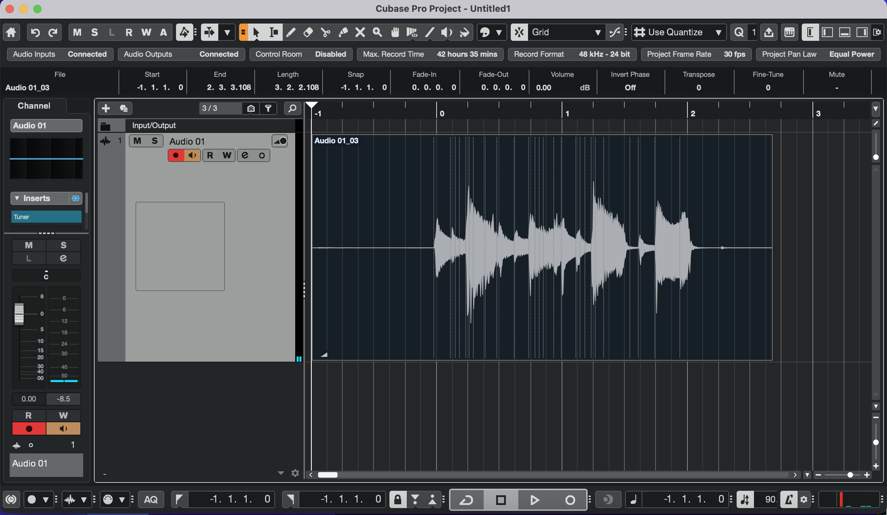 {.w-100}

歌やギターを録音できます🎤🎸 {.text-sm}
    
  

  
  

    
  - 打ち込み {.text-2xl}

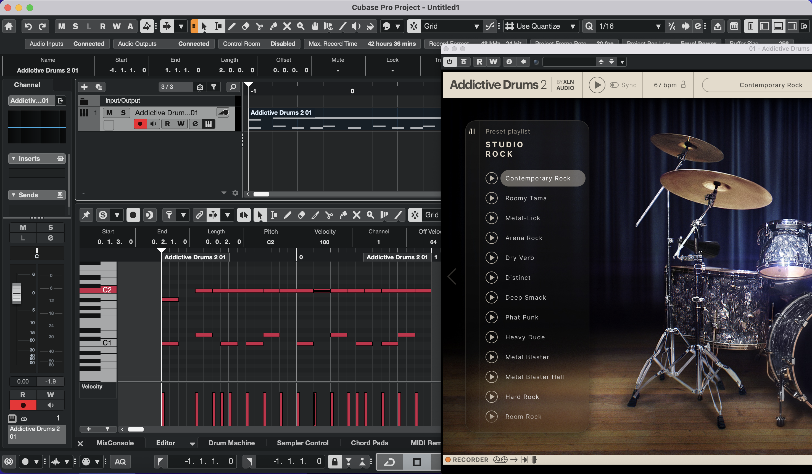 {.w-100}

MIDIの打ち込みでソフト音源を鳴らせます♪ {.text-sm}

ドラムやピアノやバイオリンや管楽器の音が再現できます🥁🎹🎻 {.text-sm}

  

  
  

---

# 例えばこんなことができます!

  

    
  - 歌ってみた {.font-bold}
  
  カラオケ音源を探して、PCにマイクを繋いで録音する! {.text-xs}
  
  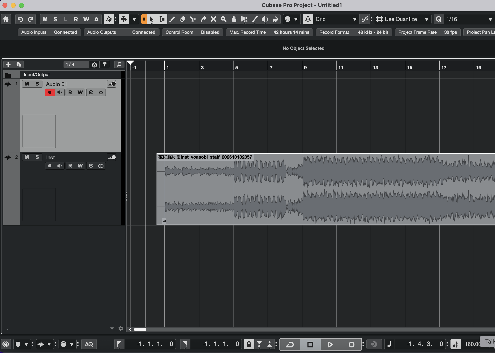 {.w-50 mx-auto}

  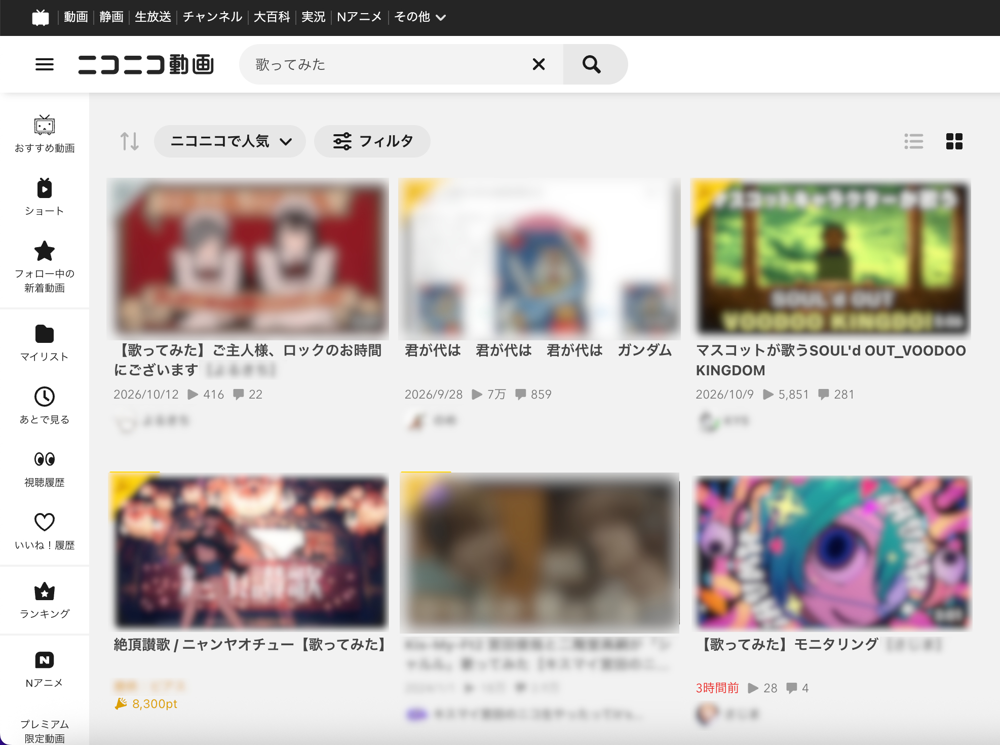 {.w-50 mx-auto}
  

  
  

  - 作曲 {.font-bold}

自分で曲を作る! {.text-xs text-center}

 {.w-40}  

  

---

# 他にもいろいろ出来ます

- バンドの同期を作る・鳴らす {.font-bold mt-15}

ドラムがいないバンドでドラムを鳴らしたり、
エレクトリックドラムの音を担当させたり、
バイオリンやトランペットなどバンドにいない楽器を担当させられます

- 自分の演奏を録音して、楽器の練習に役立てる {.font-bold}

クリックに合わせて録音するのは初めは少し難しいです
クリックに合わせて演奏出来るようになると演奏が上手になります

- バンドスコアを打ち込んで再現してみる {.font-bold}

バンドメンバーがいなくても1人で全ての楽器を担当できます
いつも聴いている曲でも楽譜を見て、打ち込んで音作りをしてみることで新しい発見があります

---
layout: center
---

# かえるの歌をアレンジしてみよう

  カエルの歌🐸 バンドアレンジVer.🥁 を作ってみます!

  ## メロディを打ち込む
  
  色々な方法で打ち込みをやってみます
  
  

- シンセサイザーを使う
- マイクで歌う
- ボーカロイドを使う
{.text-2xl font-bold space-y-4 mt-10}

---

メロディの打ち込み { .text.3xs }
# シンセサイザーを使う

MIDIでソフト音源を鳴らします

<!-- 

 -->

Cubaseの付属音源 Retrogue を使います {.text-center font-bold text-3xl}

  <ZoomImage src="/images/dtm_beginners/retrogue.png" width="10em" />

<!-- 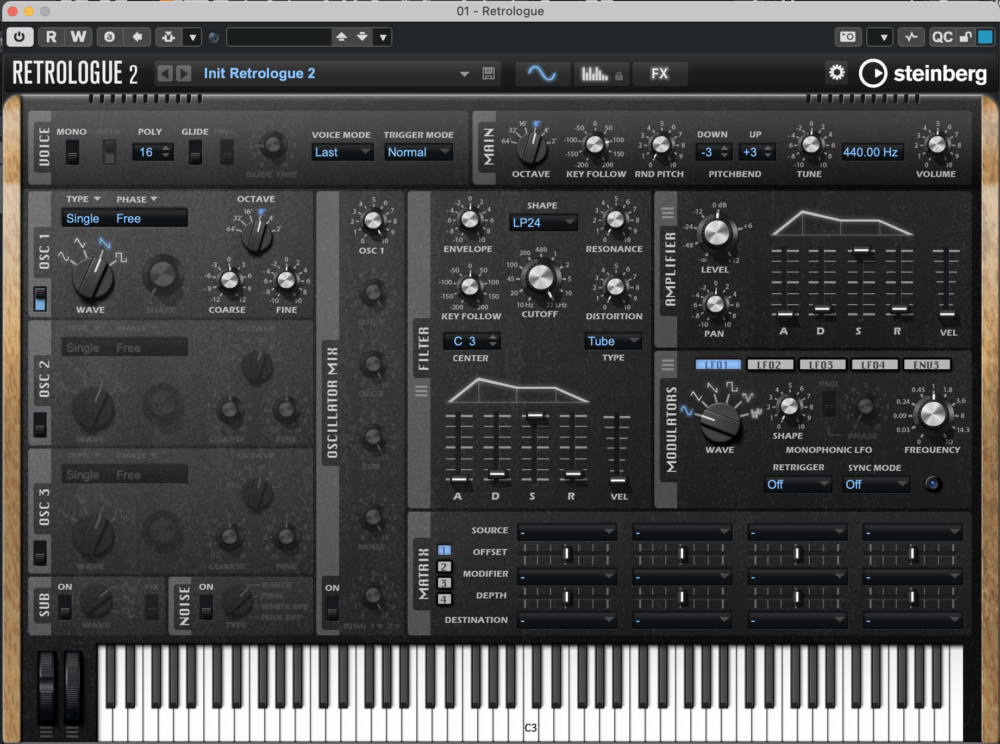 {.w-40 mx-auto} -->

  アナログシンセサイザーをコンピューター上で再現したものです {.text-center text-xs}
  
  <figure>
    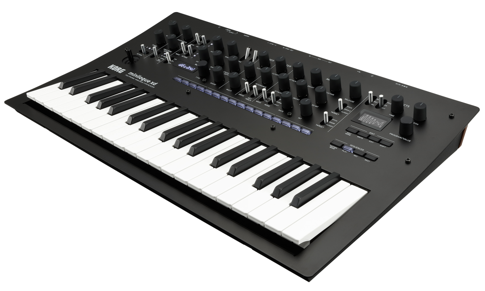
    <figcaption class="text-center text-sm">
      KORG minilogue
    </figcaption>
  </figure>

---

メロディの打ち込み { .text.3xs }
# シンセサイザーを使う

MIDIの打ち込み方は色々あります! {.text-center font-bold text-3xl}

  

  - マウスで打ち込む
  - MIDIキーボードで演奏する
  - 楽譜で書く
  - ステップ入力
  

得意な方法で打ち込みましょう! {.text-center}

---

メロディの打ち込み > シンセサイザーを使う{ .text.3xs }

# マウスで打ち込む

ピアノロールを使います

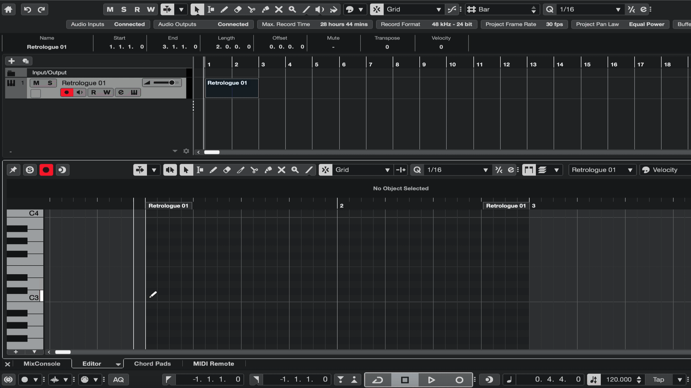 {.w-120 mx-auto}

---

メロディの打ち込み > シンセサイザーを使う{ .text.3xs}

# MIDIキーボードで演奏する

MIDIキーボードは小さなものから大きなものまで色々あります

  <figure>
    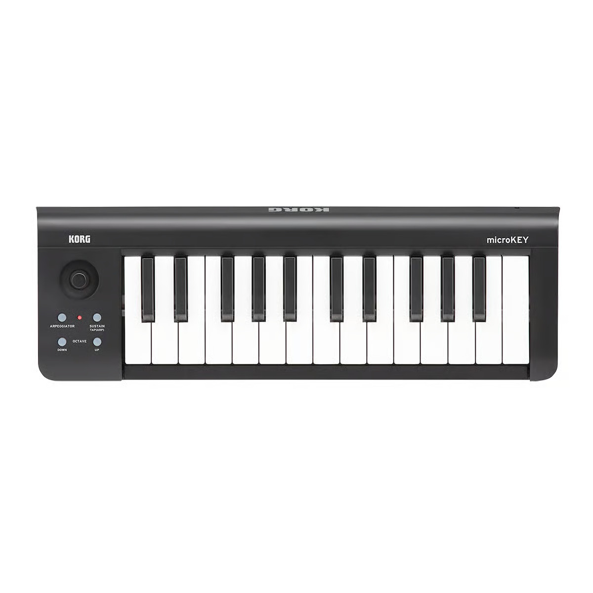
      <figcaption class="text-center">KORG microkey-25</figcaption>
  </figure>
  
  <figure>
    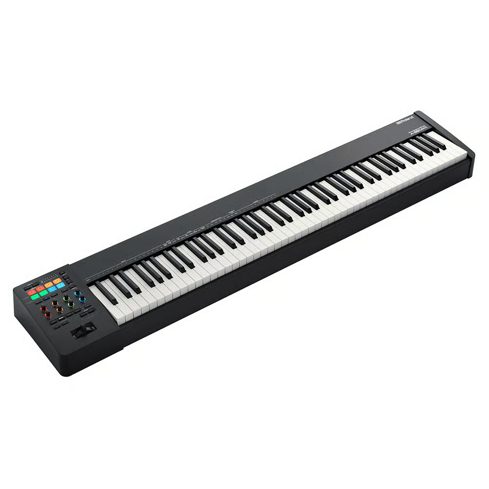 
      <figcaption class="text-center">Roland RD-88</figcaption>
  </figure>

  電子ピアノも使えます {.text-xs text-center}
  
  <figure>
    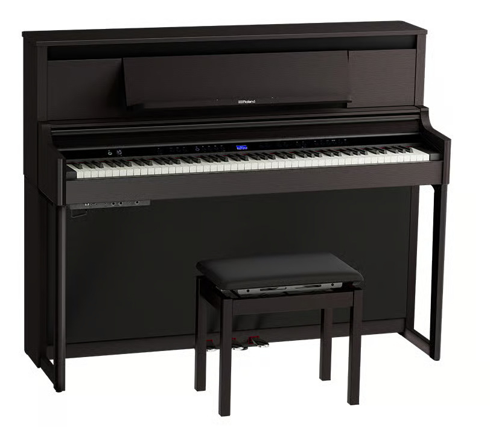
      <figcaption class="text-center">Roland LX6</figcaption>
  </figure>

---

メロディの打ち込み > シンセサイザーを使う{ .text.3xs}

# MIDIキーボードで演奏する

  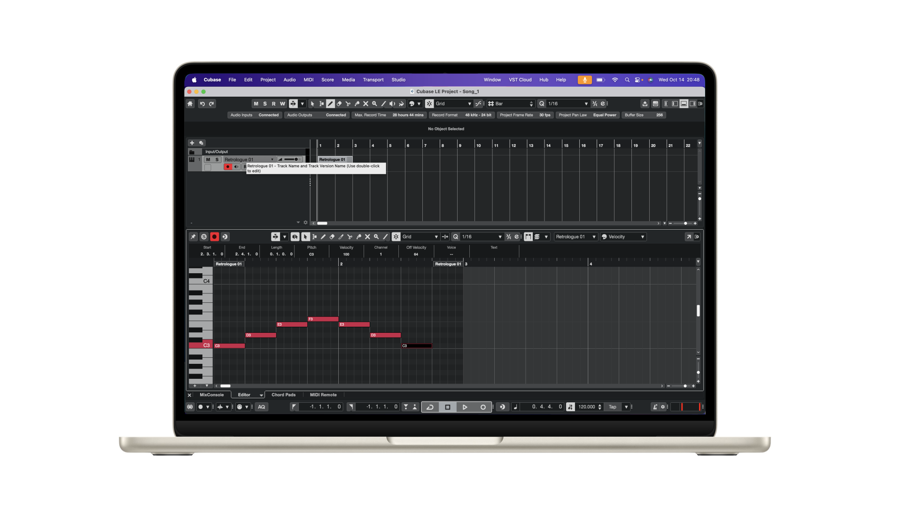
  
  

    

  USB接続 {.text-center}
  

  
  

    <figure>
      
        <figcaption class="text-center -mt-15">KORG microkey-25</figcaption>
    </figure>
  

  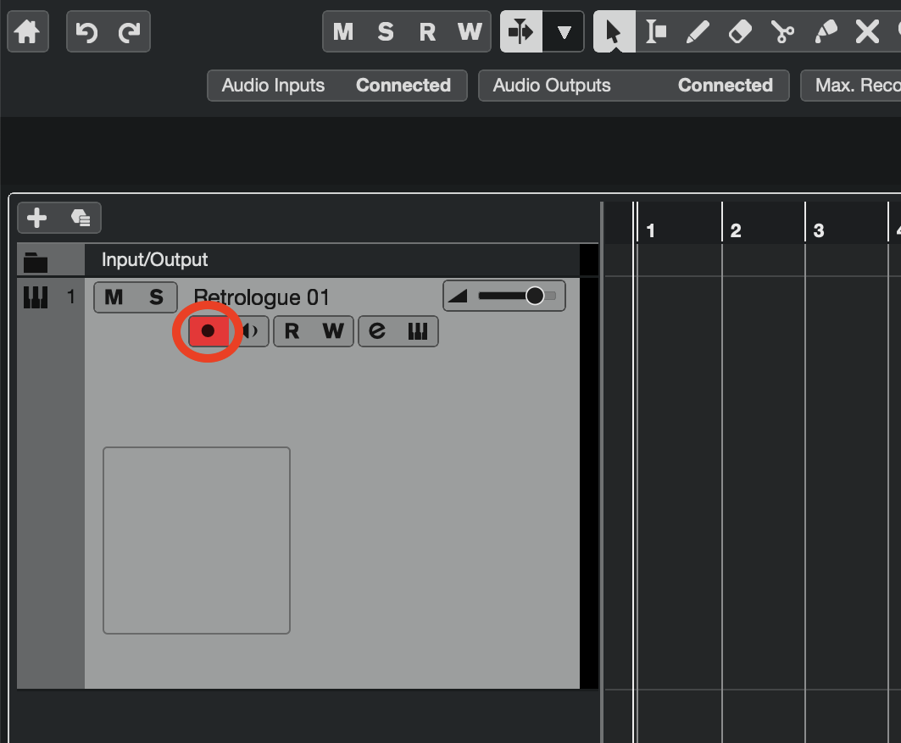 {.w-60}
  
録音を有効にするボタン(Record Enable)を押して、録音ボタンを押します {.ml-20 .text-sm}

---
メロディの打ち込み > シンセサイザーを使う{ .text.3xs }

# 楽譜を書く

## スコアエディターを使う

楽譜を書いて入力もできます

---

メロディの打ち込み > シンセサイザーを使う{ .text.3xs }

# ステップ入力

MIDIキーボードをリアルタイムで:演奏しなくてもMIDIキーボードを押さえながら長さを指定して入力する方法です
