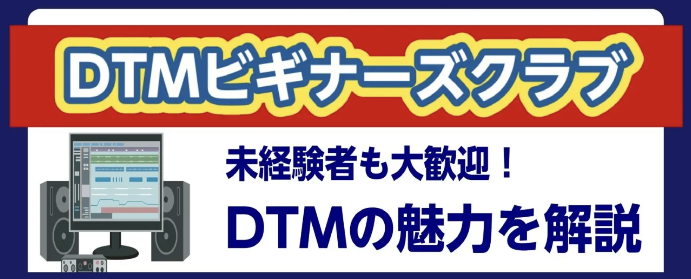

# DTM ビギナーズクラブ

  

### DTMビギナーズとは? {.font-bold}

- 「パソコンで音楽を作ってみたいけれど、難しそう…」
- 「機材は何を揃えればいいの？」

そんなお悩みをお持ちの方を対象に、島村楽器のスタッフがDTM（デスクトップミュージック）の楽しみ方を分かりやすくレクチャーいたします。
ソフトの操作体験や機材選びの相談など、最初の一歩を安心して踏み出せるようサポートします。

Cubase Proを使用し、オーディオ録音、打ち込みでの音出し、トラック作りまでを1時間弱で要点をまとめてお伝えしております。

イベント終了後には時間の許す限り個別でのご相談も受け付けておりますので、具体的に分からない点などお気軽にお尋ねください。

---

# 「DTM」って何ができるの？

  - 録音 {.text-2xl}

歌やギターを録音できます🎤🎸

